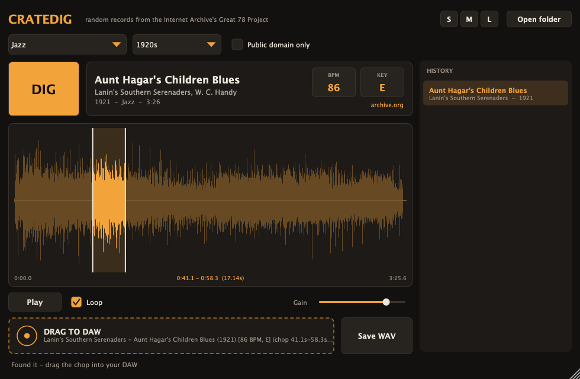
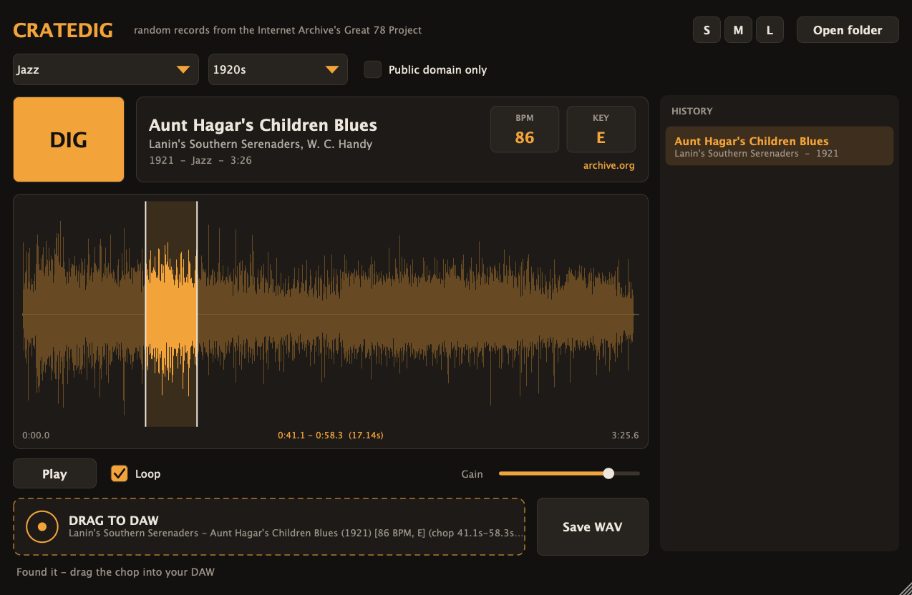

# CrateDig

**Dig random vintage records and drag them straight into your DAW.**
An AU / VST3 instrument plugin inspired by [samplette.io](https://samplette.io): hit **DIG**, hear a random
record, chop the part you like and drag it onto a track.



Records come from the Internet Archive's [Great 78 Project](https://great78.archive.org/) —
more than 180,000 digitised 78 rpm sides from 1898 to the 1950s (jazz, blues, latin, country, dance bands, opera…).

## Features

- **DIG** — pulls a random record, filtered by genre, decade, or *public domain only* (US, ≤ 1925)
- **Preview inside the plugin** — plays through the plugin output; any MIDI note retriggers the chop
- **Chop** — drag on the waveform to select a region, drag its edges to adjust, click to play from a point, double-click to clear
- **BPM & key detection** on every record
- **Drag to DAW** — drag the tile onto a track: the selection (or whole record) is written as a 24-bit WAV and dropped
- **Save WAV** — writes the same file to `~/Music/CrateDig` and reveals it
- **History** — the last 30 digs, saved with your project; click to reload
- **Resizable window** — drag the corner (760×500 up to 2200×1400) or use the S / M / L presets; size is saved per instance
- Exported files are named `Artist - Title (Year) [BPM, Key] (chop …).wav`

| Small | Large |
|---|---|
|  |  |

## Install

Download the latest build from [Releases](../../releases) (or the *Actions* tab artifacts), then:

| Format | Copy to |
|---|---|
| AU (`CrateDig.component`) | `~/Library/Audio/Plug-Ins/Components/` |
| VST3 (`CrateDig.vst3`) | `~/Library/Audio/Plug-Ins/VST3/` (macOS) · `C:\Program Files\Common Files\VST3\` (Windows) |

The macOS builds are ad-hoc signed, not notarised. If macOS blocks them, run:

```bash
xattr -dr com.apple.quarantine ~/Library/Audio/Plug-Ins/Components/CrateDig.component ~/Library/Audio/Plug-Ins/VST3/CrateDig.vst3
```

CrateDig is an **instrument**: load it on an instrument/MIDI track so the preview keeps running when the transport is stopped.

## Build from source

Requirements: CMake ≥ 3.22, a C++20 compiler (Xcode / Command Line Tools on macOS, Visual Studio 2022 on Windows). JUCE is fetched automatically.

```bash
cmake -S . -B build -DCMAKE_BUILD_TYPE=Release
cmake --build build --config Release
./build/CrateDigTests_artefacts/Release/CrateDigTests
```

Plugins land in `build/CrateDig_artefacts/Release/{AU,VST3,Standalone}`. Extra targets:

- `CrateDigSmoke [genre] [decade]` — digs a real record from archive.org end to end (network)
- `CrateDigSnapshot docs --dig` — renders the editor to PNG (configure with `-DCRATEDIG_BUILD_SNAPSHOT=ON`)

## How it works

```
DIG ─► Digger thread ─► archive.org advancedsearch (random year + sort + offset)
                    ─► /metadata/{id}/files → pick the VBR MP3
                    ─► download to ~/Library/Caches/CrateDig → decode → normalise → BPM / key
     ◄─ message thread: preview buffer swapped into the audio thread (try-lock, no allocation)
Drag ─► 24-bit WAV export of the selection → DragAndDropContainer::performExternalDragDropOfFiles
```

| Path | Role |
|---|---|
| `Source/Core/ArchiveApi.*` | Query building and JSON parsing (pure, unit-tested) |
| `Source/Core/Digger.*` | Background search / download / decode / analysis |
| `Source/Core/Analysis.*` | Onset-autocorrelation BPM, Krumhansl–Schmuckler key |
| `Source/Core/Exporter.*` | File naming and WAV export |
| `Source/PluginProcessor.*` | Preview playback, MIDI retrigger, state (size, filters, history) |
| `Source/PluginEditor.*`, `Source/UI/*` | Resizable UI, waveform/chop view, drag tile |

## Rights & fair use

The Great 78 Project is an archive for preservation and research. Recordings published in the US **before 1926**
are in the public domain there; later ones may still be protected, and the rules differ in other countries.
Tick **Public domain only** if you plan to release what you make, and always check the rights of a sample
before publishing music that uses it. CrateDig is not affiliated with samplette.io or the Internet Archive.

## Licence

[AGPL-3.0](LICENSE). Built with [JUCE](https://juce.com) (AGPLv3).

---

### 🇫🇷 En bref

CrateDig est un plugin AU / VST3 inspiré de samplette.io : bouton **DIG** pour tirer un disque 78 tours au hasard
(Internet Archive, filtre par genre / décennie / domaine public), pré-écoute dans le plugin, sélection d'un *chop*
sur la forme d'onde, détection BPM / tonalité, puis **glisser-déposer direct dans le DAW** (WAV 24 bits, aussi
enregistré dans `~/Music/CrateDig`). La fenêtre est redimensionnable (coin en bas à droite ou boutons S / M / L).
